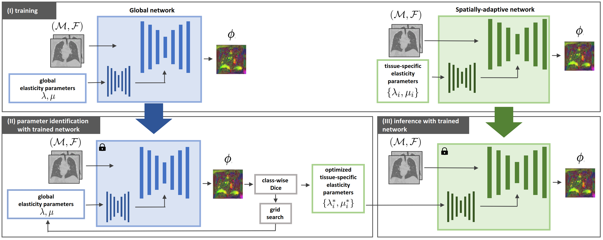

# Data-Driven Tissue- and Subject-Specific Elastic Regularization for Medical Image Registration (MICCAI 2024)


Code for **"Data-Driven Tissue- and Subject-Specific Elastic Regularization for Medical Image Registration"**
*Anna Reithmeir, Lina Felsner, Rickmer Braren, Julia A. Schnabel, Veronika A. Zimmer* — MICCAI 2024

[Paper (DOI)](https://doi.org/10.1007/978-3-031-72069-7_54) · [arXiv](https://arxiv.org/abs/2407.04355)

## Abstract

Physics-inspired regularization is desired for intra-patient image registration since it can effectively capture the biomechanical characteristics of anatomical structures. However, a major challenge lies in the reliance on physical parameters: parameter estimations vary widely across the literature, and the physical properties themselves are inherently subject-specific. In this work, we introduce a data-driven method that leverages hypernetworks to learn the tissue-dependent elasticity parameters of an elastic regularizer. Our approach facilitates the estimation of patient-specific parameters without the need to retrain the network. We evaluate our method on three publicly available 2D and 3D lung CT and cardiac MR datasets, and find that our proposed subject-specific tissue-dependent regularization achieves higher registration quality than a global regularizer across all datasets.

**Keywords:** Medical Image Registration · Spatially Adaptive Regularization · Hypernetworks · Patient-Specific Modeling

## Method overview



We train a globally and a spatially adaptive hypernetwork. After training, the optimal tissue-specific elasticity parameters are estimated with the global network; the spatially adaptive network then predicts the deformation field for a new image pair following the physical properties specified by those parameter values.

## Repository contents

| File / folder | Description |
|---|---|
| `hypermorph_spatially_adaptive/` | The spatially adaptive model implementations |
| `train_hypermorph_elastic.py` | Trains the global elastic hypernetwork |
| `train_hypermorph_elastic_spatially_adaptive_vector.py` | Trains the spatially adaptive elastic hypernetwork |
| `train_hypermorph_diffusion.py` | Trains the global diffusion hypernetwork |
| `train_hypermorph_diffusion_spatially_adaptive_vector.py` | Trains the spatially adaptive diffusion hypernetwork |
| `parameter_identification.py` | Identifies the best regularization parameters using the global model |
| `inference.py` | Runs inference with the spatially adaptive model and the identified parameters |
| `datasets.py` | Dataloaders for the NLST, Learn2Reg Lung CT, and ACDC datasets |
| `regularizers.py` | The linear elastic regularizer |
| `eval_metrics.py` | Evaluation metrics |
| `utils.py` | Shared helper functions |
| `environment.yml` | Conda environment specification |

Some parts of the code are based on the [Voxelmorph/HyperMorph](https://github.com/voxelmorph/voxelmorph) codebase.

## Setup

```bash
conda env create -f environment.yml
conda activate elastic-hypermorph   # adjust to the environment name in environment.yml
```

## Usage

**1. Train the global model** and identify subject-specific elasticity parameters:

```bash
python train_hypermorph_elastic.py --data-dir /path/to/dataset --out-dir /path/to/output
python parameter_identification.py --checkpoint /path/to/output/checkpoint.pt --data-dir /path/to/dataset
```

**2. Train the spatially adaptive model** conditioned on the identified parameters:

```bash
python train_hypermorph_elastic_spatially_adaptive_vector.py --data-dir /path/to/dataset --out-dir /path/to/output
```

**3. Run inference** on a new image pair:

```bash
python inference.py --checkpoint /path/to/output/checkpoint.pt --moving path/to/moving.nii.gz --fixed path/to/fixed.nii.gz
```

> Replace the flags above with whatever `argparse` options your scripts actually expose (`python train_hypermorph_elastic.py --help`) — fill in the exact flag names here so a reader can copy-paste a working command directly.

## Datasets

Trained and evaluated on three public datasets: [NLST](https://learn2reg.grand-challenge.org/), Learn2Reg Lung CT, and [ACDC](https://www.creatis.insa-lyon.fr/Challenge/acdc/). See `datasets.py` for the expected data layout.

## Citation

If you use this code, please cite:

```bibtex
@inproceedings{reithmeir2024data,
  title     = {Data-Driven Tissue- and Subject-Specific Elastic Regularization for Medical Image Registration},
  author    = {Reithmeir, Anna and Felsner, Lina and Braren, Rickmer and Schnabel, Julia A. and Zimmer, Veronika A.},
  booktitle = {Medical Image Computing and Computer Assisted Intervention -- MICCAI 2024},
  series    = {Lecture Notes in Computer Science},
  volume    = {15002},
  publisher = {Springer, Cham},
  year      = {2024},
  doi       = {10.1007/978-3-031-72069-7_54}
}
```

## License
[](LICENSE)
